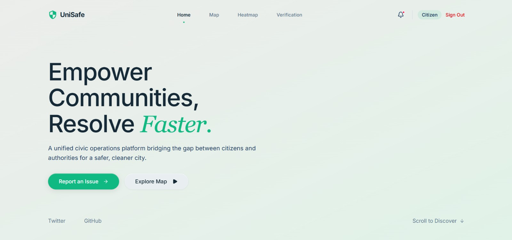
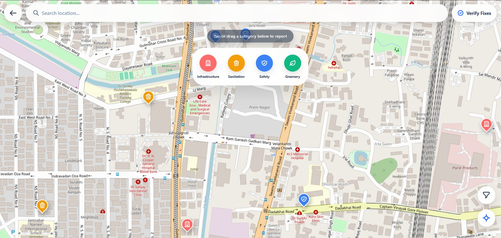
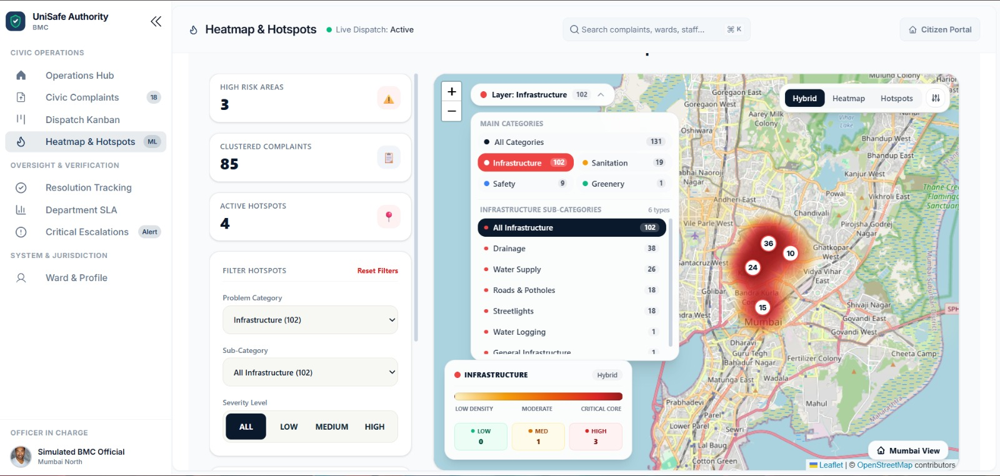
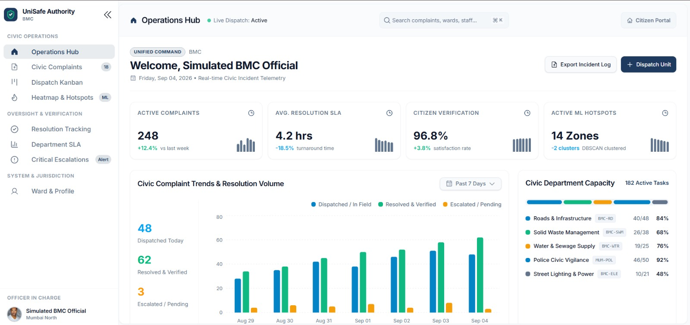
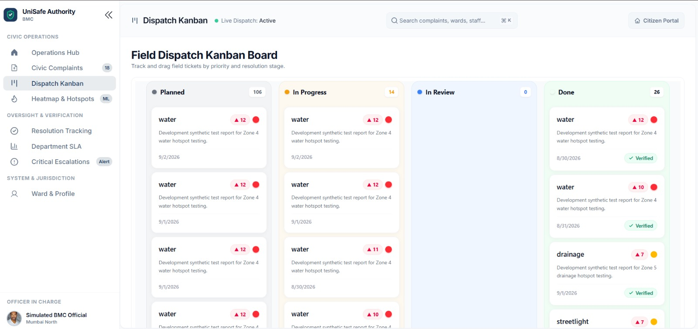
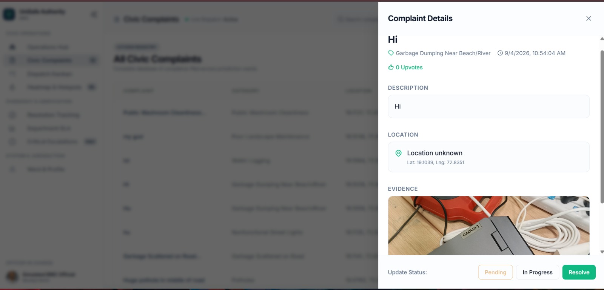
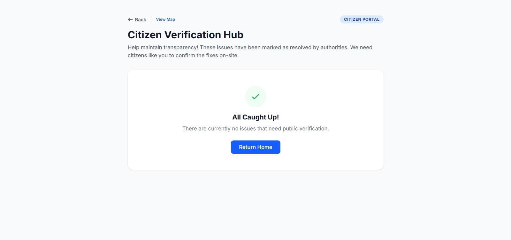

# UniSafe — Web Prototype

UniSafe is a civic safety and issue management platform designed to help citizens report local issues and help authorities monitor, prioritize, and resolve them efficiently.

This web prototype was developed during a hackathon and focuses on connecting citizen complaints with authority workflows through interactive maps, complaint tracking, heatmap-based hotspot analysis, notifications, and verification.

## Features

### Citizen Side

* Submit and view civic complaints
* Interactive map for locating reported issues
* Upvote complaints to highlight issues that need attention
* Track complaint status
* Receive notifications and updates
* View complaint resolution and verification information

### Authority Side

* Role-based authority dashboards
* Police and BMC-specific dashboards
* View and manage assigned complaints
* Kanban-based complaint workflow
* Complaint details and status management
* Authority assignment
* Priority and performance views
* Notifications for complaint-related events

### Heatmap & Hotspot Analysis

* Visualize complaint concentration on an interactive heatmap
* Categorize complaints hierarchically
* Identify high-density complaint areas
* Generate hotspot information from complaint data
* Filter and inspect hotspot details
* Support authority decision-making through spatial complaint analysis

### Resolution & Verification

* Track complaints through different stages
* Submit resolution information
* Citizen-side resolution verification
* Maintain a clearer workflow between reporting, assignment, resolution, and verification

## Tech Stack

### Frontend

* React
* Vite
* Tailwind CSS
* React Router
* React Leaflet / Leaflet
* Recharts
* Lucide React
* Motion
* Supabase JavaScript Client

### Backend

* Python
* Flask
* Flask-CORS
* SQLAlchemy
* Supabase
* bcrypt
* python-dotenv
* Requests

## Screenshots

### Home



### Interactive Map



### Heatmap & Hotspots



### Authority Dashboard



### Kanban Board



### Complaint Details(Authority) & Verification(Citizens)




## Project Structure

```text
UniSafe_Web_Prototype/
│
├── backend/
│   ├── app/
│   │   ├── heatmap/
│   │   ├── notifications/
│   │   ├── routes/
│   │   ├── services/
│   │   ├── auth_routes.py
│   │   ├── models.py
│   │   └── supabase_client.py
│   │
│   ├── requirements.txt
│   └── run.py
│
├── frontend/
│   ├── src/
│   │   ├── components/
│   │   ├── pages/
│   │   ├── screens/
│   │   ├── services/
│   │   └── hooks/
│   │
│   ├── package.json
│   └── vite.config.js
│
└── README.md
```

## Getting Started

### Prerequisites

Make sure you have installed:

* Python 3.x
* Node.js
* npm
* A Supabase project

### 1. Clone the repository

```bash
git clone https://github.com/itssmansi/UniSafe_Web_Prototype.git
cd UniSafe_Web_Prototype
```

### 2. Backend Setup

Create and activate a virtual environment:

```bash
cd backend
python -m venv venv
```

Windows:

```bash
venv\Scripts\activate
```

Install the dependencies:

```bash
pip install -r requirements.txt
```

Create the required environment variables for your Supabase configuration.

Start the Flask backend:

```bash
python run.py
```

### 3. Frontend Setup

Open another terminal:

```bash
cd frontend
npm install
```

Start the development server:

```bash
npm run dev
```

The frontend will then be available at the local Vite development address shown in the terminal.

## Team Contributions

### Mansi

* Developed the complaint heatmap module
* Worked on ML-based hotspot analysis and clustering
* Implemented heatmap-related processing, scoring, and API integration

### Pranav

* Developed the interactive map
* Built the Kanban complaint workflow
* Worked on authority dashboards and related authority-side functionality

### Seana

* Worked on registration and authentication flows
* Implemented notification functionality
* Worked on citizen notification components and notification-related backend integration

## Future Scope

UniSafe can be extended into a larger civic safety platform with features such as:

* Mobile application for citizens
* Advanced complaint prioritization
* Real-time authority coordination
* More detailed geospatial analytics
* Improved verification and escalation workflows
* Additional civic and public-safety modules

## Project Status

This repository contains the **UniSafe web prototype**. It demonstrates the core citizen complaint, authority management, mapping, heatmap, notification, and resolution workflows.